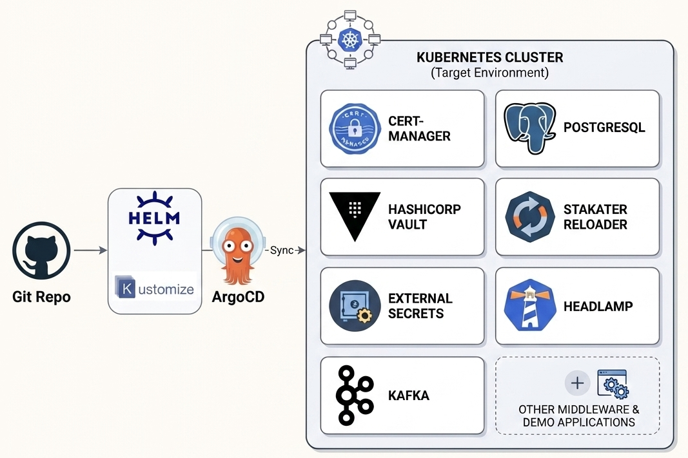

# Kubernetes GitOps Platform

This repository contains a collection of "Wrapper" Helm charts and Kustomize overlays used to bootstrap a standardized environment on a Kubernetes or OpenShift cluster with all the middleware components required for POCs and demo projects.

The goal is to provide a consistent "Landing Zone" for POC applications, ensuring they have immediate access to middleware dealing with cross-cutting concerns such as security, config / secret management, database services, etc., regardless of the underlying cluster type.

> [!WARNING]
> Although this is built for demos and POCs, it follows real security practices — mTLS, certificate
> rotation, dynamic credentials — but always review all configurations before using it for any real production project.

## Platform Architecture

The following diagram shows how the components interact to create a secure, automated environment. Even though this is a demo / POC environment, it uses mTLS, certificate rotation, secret orchestration, and various other concepts to mimic a production-grade architecture.



## Components Catalog

| S.No | Component | Purpose | Status |
| --- | --- | --- | --- |
| 1 | [Cert-Manager](./cert-manager/) | Automates TLS certificate issuance and renewal. | ✅ Ready |
| 2 | [HashiCorp Vault](./hashicorp-vault/) | Centralized secret management and dynamic credential generation / rotation. | ✅ Ready |
| 3 | [External Secrets](./external-secrets/) | Syncs secrets from Vault into native Kubernetes Secrets. | ✅ Ready |
| 4 | [PostgreSQL](./postgres/) | Secure, TLS-enabled database with Vault credential creation / rotation. | ✅ Ready |
| 5 | [Stakater Reloader](./stakater-reloader/) | Triggers automatic app restarts when Secrets/ConfigMaps change so that the new config / secret values are loaded into the app. | ✅ Ready |
| 6 | [Headlamp](./headlamp/) | Modern Kubernetes UI (dashboard), required only for standard Kubernetes clusters. OpenShift uses its native console instead. | ✅ Ready |
| 7 | [Kafka](./kafka/) | Distributed event streaming platform for high-performance data pipelines. | ❌ To Do |

## Before you start

- Ensure you have access to a running Kubernetes / OpenShift cluster.
  - See my [infra-setup](https://github.com/Microservices-Demo-Projects/infra-setup) repo for instructions to quickly set up:
    - [**Local Kubernetes cluster using KIND**](https://github.com/Microservices-Demo-Projects/infra-setup/tree/main/local-kind-cluster)
    - [**OpenShift using Code Ready Containers (CRC)**](https://github.com/Microservices-Demo-Projects/infra-setup/tree/main/local-openshift-cluster)
    - [**AWS - EKS cluster**](https://github.com/Microservices-Demo-Projects/infra-setup/tree/main/aws-eks-cluster-iac)

- Then ensure you have ArgoCD installed in the cluster:
  - [**Kubernetes**](./argocd/kubernetes/0-prerequisite-argocd-setup/local-argocd-setup.md) — upstream ArgoCD manifests
  - [**OpenShift**](./argocd/openshift/0-prerequisite-argocd-setup/local-argocd-setup.md) — Red Hat OpenShift GitOps Operator
  - [**HA & multi-tenant**](https://github.com/Microservices-Demo-Projects/infra-setup/blob/main/argocd-setup/ha-multi-tenant-argocd-setup.md) — for AWS EKS

- Additionally it is convenient to have the common CLI utilities: `oc` / `kubectl`, `helm`, `kustomize`, `argocd`, `aws`, `terraform`, etc.

## Install

A single command deploys everything — in the right sequence (ArgoCD sync waves) and with all the appropriate configuration and validation (ArgoCD PreSync / PostSync hooks).

- **Kubernetes cluster:**
  ```bash
  kubectl apply -f argocd/kubernetes/bootstrap/
  ```
- **OpenShift cluster:**
  ```bash
  oc apply -f argocd/openshift/bootstrap/
  ```

Then wait 10-15 minutes for all apps to go `Synced` and `Healthy`:
```bash
kubectl get applications -n argocd -w              # OpenShift: -n openshift-gitops
```

That's the whole install. For the sync wave order, troubleshooting, or installing components without the bootstrap manifests, see **[./argocd/README.md](./argocd/README.md)**.

## Installing without ArgoCD

Every component can be installed by hand with `helm` and `kubectl` — useful for learning how a piece works, or debugging one in isolation. Each component has a `manual/README.md` with the steps.

Install them in the order listed in **[./argocd/README.md](./argocd/README.md)**; in many cases the later ones depend on earlier ones.

## Components Directory Structure

Every component follows the same shape:

```text
<component>/
  common/        Manifests and tests shared by both platforms
  kubernetes/    Kubernetes-specific install (values, overlays)
  openshift/     OpenShift-specific install (values, overlays, SCC, operator)
  manual/        Instructions for installing by hand
```

Within `common/`, `kubernetes/` and `openshift/`:

```text
  chart/     Wrapper Helm chart around the upstream chart
  config/    Extra resources (custom resources, certificates, RBAC)
  tests/     Prerequisite gate ArgoCD runs before syncing, smoke test after
  values.yaml
```

ArgoCD's own manifests live in [`argocd/`](./argocd/).
